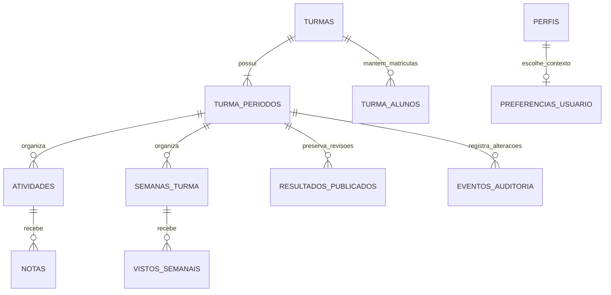
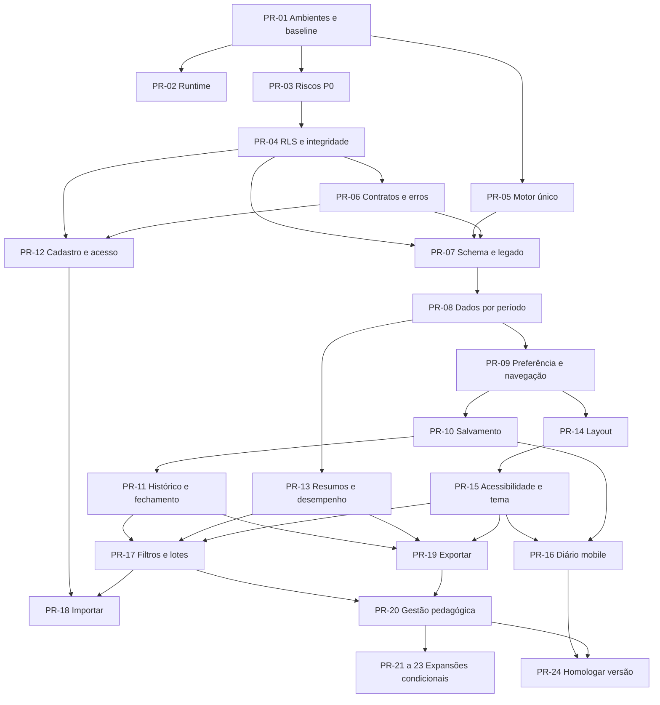

# Plano de implementação — Média Fácil

Data da revisão: **21 de outubro de 2026**. Base: [relatório de 30/09/2026](RELATORIO.md), código do checkout `502ff86` e verificações locais descritas abaixo.

**Resultado pretendido:** manter o histórico do terceiro bimestre, permitir trabalhar no quarto sem apagar lançamentos anteriores, restaurar automaticamente o período escolhido e corrigir os problemas de segurança, cálculo, persistência e experiência apontados no relatório.

Este documento é a especificação e a divisão proposta de trabalho em PRs. Os números PR-01 a PR-24 são identificadores do plano, não pull requests já abertos. A funcionalidade de bimestres ainda não foi implementada. Não houve alteração do banco remoto, de credenciais, de notas reais ou da implantação na Vercel nesta revisão.

Leitura rápida: [avaliação do relatório](#1-avaliação-crítica-do-relatório) · [bimestres e migração](#3-especificação-dos-bimestres) · [PRs detalhadas](#5-plano-dividido-em-prs) · [sequência e esforço](#6-sequência-marcos-e-estimativas) · [cobertura de todos os itens](#7-matriz-de-cobertura-do-relatório-e-do-pedido) · [testes e aceite](#8-plano-de-testes-e-critérios-de-liberação).

## 1. Avaliação crítica do relatório

### O que faz sentido

O diagnóstico é consistente com o código atual. A prioridade de corrigir acesso, regra acadêmica e gravação antes de ampliar funcionalidades é adequada. O relatório distingue bem evidência de código, demonstração local e hipóteses sobre produção. Também acerta ao preservar a identidade visual e recomendar uma correção estrutural do layout.

É um relatório técnico detalhado, adequado como registro de análise. Não é uma especificação pronta para execução: os achados reaparecem nas seções de problemas, design e etapas, e faltam contratos, dependências entre PRs e decisões sobre períodos. Este plano acrescenta essas definições e uma matriz de cobertura para não perder itens.

### Ajustes necessários

1. **Antecipar os bimestres.** O relatório coloca períodos na última etapa. A necessidade atual torna essa uma fundação: pesos, atividades, semanas, consultas, resumos, exportações e histórico precisam nascer com escopo de período.
2. **Não tratar riscos SQL como exploração comprovada em produção.** S01/S02 existem nas migrações; os grants efetivos precisam ser inspecionados. S03 depende também do signup e do trigger efetivamente ativos. O tratamento continua prioritário.
3. **Separar decisões pedagógicas de correções técnicas.** Uma função única resolve a divergência, mas não decide se ausência deve valer zero, se haverá recuperação substitutiva ou como arredondar. Não recalcular o terceiro bimestre sob uma regra nova sem comparação e homologação.
4. **Atualizar a auditoria.** Em 21/10/2026, `npm audit` retornou **7 pacotes sinalizados: 6 altos e 1 moderado**, com correções disponíveis. Além dos cinco do relatório, aparecem `source-map-js` e `vite`. O resultado depende do lockfile e do registro na data da consulta; não equivale a sete falhas exploráveis no navegador.
5. **Reavaliar a estimativa.** A faixa original de 25–39 dias era indicativa. Bimestres completos, migração dos dados, preferência entre dispositivos e fechamento auditável aumentam o trabalho. O primeiro ciclo de dez dias deve ser um marco parcial, não promessa de resolver segurança, períodos, cálculos e todo o mobile.
6. **Corrigir a definição de offline.** A base local é uma demonstração independente, não cópia sincronizada do banco da Vercel. Realtime e offline continuam decisões próprias, com entregas e testes específicos.
7. **Atualizar linhas de referência conforme os PRs.** As linhas do relatório são uma fotografia; os nomes de funções, contratos e critérios de aceite são referências mais duráveis.

### Verificações desta revisão

| Verificação | Resultado em 21/10/2026 | Limite |
|---|---|---|
| `npm run lint` | Passou | Não comprova autorização nem regra de produto |
| `npm run build` | Passou; Vite 8.0.16; entrada 240,98 kB / 73,44 kB gzip | Não testa o backend remoto |
| `tests/unit/calculations.spec.js` | 8/8 passaram | Executados com configuração temporária sem servidor, navegador ou limpeza remota |
| Reprodução isolada de F03 | Função central: `0.0`; algoritmo lateral sem lançamentos: `3.0` | Reprodução dos algoritmos do código, não de dados reais |
| `npm audit --json` | 7 pacotes sinalizados | Nenhuma atualização aplicada nesta tarefa |
| Configuração local | Apenas `.env.example`; modo simulado por ausência de configuração | Configurações da Vercel não foram consultadas |
| Design | Código e capturas `diario-mobile.png` e `diario-tablet.png` revisados | Capturas são de 30/09; não houve nova medição de viewport nesta sessão |
| Banco, grants, RLS e dados reais | Não consultados | Validar no PR-01; sem alegação de auditoria remota concluída |
| E2E completo | Não executado | Configuração atual pode usar `.env` remoto e chama limpeza privilegiada |

Não havia navegador automatizável disponível nesta sessão. As conclusões visuais novas são de inspeção estática e revisão das capturas existentes, não de uma nova homologação em dispositivos. Foram consultadas referências oficiais atuais, relacionadas na seção 10.

## 2. Revisão geral do software

### Base que deve ser aproveitada

- React/Vite, telas com carregamento lazy e componentes separados permitem evoluir sem reescrever o produto.
- Portal do aluno com composição da média, Prova Paulista e vistos são funcionalidades úteis a preservar.
- Há identidade visual reconhecível, tokens de tema, validação de soma dos pesos, ordenação e uma base de testes de cálculo.
- O bundle observado não justifica, por si só, trocar framework ou introduzir virtualização.

### Gargalos e riscos confirmados no código

| ID | Evidência atual | Consequência e encaminhamento |
|---|---|---|
| A01 | `App.jsx:139–151` chama um relatório e depois outro por disciplina; `db.js:getStudentReport` faz oito consultas no caminho completo | Para N disciplinas, o caminho atual pode chegar a `8 × (N + 1)` consultas, sem contar Auth. Agregar perfil/matrículas e limitar notas ao período; PR-13 |
| A02 | `Dashboard.jsx:168` chama `getStudentsByClass` dentro do render e acessa `.length` de uma Promise | Contagem vazia e consultas repetidas; substituir por resumo carregado/agregado, PR-13 |
| A03 | `ClassView.jsx:handleGradeChange` grava a cada alteração e só depois agenda recarga completa | Atraso não é debounce; pode haver sobrescrita visual e perda do último valor; PR-06/10 |
| A04 | `ClassView.jsx` faz `find/filter` de notas e vistos dentro de renderização e comparadores | Custo cresce com alunos e colunas; construir índices em memória e resumos por contexto, medir antes de virtualizar; PR-13 |
| A05 | Migrações não declaram índices específicos para vários filtros/FKs além das PKs e uniques | Candidatos: professor em turmas, aluno em matrículas, atividade em notas e filtros de período; confirmar com `EXPLAIN` e volume representativo; PR-04/07/13 |
| A06 | `ClassView.jsx:getFilteredStudents` usa `s.matricula.toLowerCase()`; a coluna aceita nulo | Busca pode falhar em dados válidos sem matrícula; normalizar campos opcionais, PR-06/17 |
| A07 | `semanas_turma` tem PK `(turma_id, semana)` e vistos têm unique `(aluno_id, turma_id, semana)` | Reiniciar semana 1 no quarto bimestre conflita com o terceiro; remodelar chaves e FKs, PR-07/08 |
| A08 | `updateClassWeights` altera `turmas.pesos` globalmente | Uma mudança no quarto recalcularia o terceiro; critérios pertencem ao período, PR-07/08/11 |
| A09 | `removeStudentFromClass` apaga o vínculo; exclusão de turma/atividade usa cascata; `deleteWeekFromClass` faz dois deletes separados | Histórico pode desaparecer da interface; semana e vistos podem divergir em falha intermediária. Adotar histórico de matrícula, arquivamento e operações atômicas, PR-04/08/11 |
| A10 | Políticas de notas verificam o dono da atividade, mas não exigem que o aluno esteja matriculado na turma correspondente | Validar vínculo aluno–turma–atividade também no banco; vistos precisam referenciar semana existente, PR-04/07/08 |
| A11 | `App.jsx:getInitialUser` procura qualquer chave contendo `auth-token` e usa `user_metadata.tipo`; a simulação é inicializada incondicionalmente em `db.js:109` | Mistura de fontes de sessão/modos e papel não confiável para decisões de interface. Usar cliente configurado, perfil autorizado e estado de sessão resolvida, PR-01/03/09 |
| A12 | E2E carrega `.env`, reutiliza servidor existente e executa `clean_test_data`; scripts têm credenciais fixas e cadastro administrativo por RPC | Isolar configuração e dados de teste antes de ampliar a suíte; não executar esses scripts contra produção, PR-01/03/12 |
| A13 | `db.js` frequentemente transforma erro de consulta em `[]`/`null`; `saveGrade` e `saveVistoSemanal` não verificam erro | “Nenhum aluno” pode significar falta de permissão/conexão. Contratos e estados distintos para vazio, erro e carregamento, PR-06 |
| A14 | Ano/semestre aparecem como strings fixas; turma e disciplina estão representadas pelo mesmo registro e nome composto | Estruturar ano letivo e manter o significado atual de turma/disciplina sem reescrever todos os cadastros; PR-01/07/09/20 |

As contagens de consultas são derivadas da sequência do código; não são medição de latência da produção. Lentidão real de banco, plano de execução, volume, Core Web Vitals e estabilidade de conexão continuam hipóteses a medir.

### Direção de design

Preservar a paleta e a fonte principal. Priorizar, nesta ordem: página que cabe na tela, contexto do bimestre evidente, lançamento confiável, legibilidade e acabamento visual.

- Layout único para professor/aluno/perfis: sidebar no desktop e gaveta com cabeçalho compacto no celular; recuo lateral apenas no breakpoint correspondente.
- Cabeçalho do diário: turma/disciplina, **2026 · 4º bimestre**, estado do período e ação “Critérios de avaliação”. Código técnico fica nos detalhes.
- Abas curtas: Boletim, Provas, Paulista, Atividades, Vistos; textos explicativos ficam no conteúdo.
- Indicadores reais de pendências/cobertura substituem números fixos e cartões promocionais. Saudação usa nome preferido, sem reduzir “Prof. Ismael” a “Prof.”.
- Nome e matrícula dominam a tabela; e-mail fica nos detalhes. Rolagem horizontal restrita à tabela, primeira coluna fixa; celular ganha fluxo por aluno/avaliação.
- Componentes comuns para campos, botões, status, mensagens, estados vazios e diálogos; ações disponíveis por toque/teclado, sem depender de hover.
- Tipografia de corpo 14–16 px, metadados legíveis, números tabulares, labels associados e contraste medido em ambos os temas. Alvos de toque devem atender WCAG 2.2 AA, preferindo 44 px nas ações frequentes quando houver espaço.
- Trocar `text-white` fixo por cores `on-*`, reduzir correções globais com `!important`, definir tokens ausentes e consolidar Tailwind 4/CSS/DESIGN.md. Revisar fontes e ícones redundantes.
- Datas em `pt-BR`, correções de linguagem, ajuda operacional no lugar de link para `DESIGN.md`, distinção explícita entre visto de caderno e frequência.

Critérios técnicos de acessibilidade: referência [WCAG 2.2](https://www.w3.org/WAI/WCAG22/quickref/); a homologação também deve incluir teclado, zoom, toque e leitor de tela.

## 3. Especificação dos bimestres

### 3.1. Experiência esperada

1. O professor entra e encontra o último contexto salvo, por exemplo **2026 · 4º bimestre**. Não há pergunta nem modal de seleção em cada login.
2. Um seletor discreto de ano e bimestre fica no cabeçalho compartilhado e nas configurações. A mudança é manual e esporádica; não haverá cronômetro ou mudança automática por data.
3. Ao mudar para o quarto, permanecem as turmas e os alunos daquele ano. Provas, Paulista, atividades, vistos, pesos e médias exibidos pertencem exclusivamente ao quarto.
4. O quarto começa sem notas e sem vistos. O terceiro permanece disponível para consulta e, se aberto, correção autorizada. Trocar período não apaga, fecha ou publica o anterior.
5. Sair, voltar, recarregar, abrir outra tela ou entrar novamente restaura o quarto. No modo cloud, a preferência fica na conta e também funciona em outro dispositivo.
6. O aluno também pode consultar os períodos aos quais tem acesso, com sua própria preferência. A escolha do professor não altera a preferência do aluno nem publica resultados.
7. A tela vazia mostra “Sem lançamentos neste bimestre” e oferece a ação docente adequada. Não apresenta reprovação nem inventa nota dez.
8. Ao acessar um período encerrado, o cabeçalho mostra essa condição e os campos ficam somente para leitura. A restrição também é imposta no banco.
9. Um link para um bimestre antigo abre esse contexto após validar acesso, mas não substitui silenciosamente a preferência. A ação “Usar este período como padrão” pode salvá-lo explicitamente.
10. Se a preferência não existir mais ou não for acessível, usar um contexto válido e mostrar aviso discreto. Não trocar silenciosamente para outro banco, apagar histórico ou abrir lançamentos no ano errado.

Exemplo de navegação, sem implicar um redesenho visual completo:

```text
Média Fácil                              [2026 ▾] [4º bimestre ▾]
2º E · Redes de Computadores              Em andamento
[Boletim] [Provas] [Paulista] [Atividades] [Vistos]
Critérios de avaliação · Última gravação salva
```

### 3.2. Escopo das entidades

**Turma é anual; lançamento é bimestral.** No modelo atual, cada turma funciona como uma oferta de disciplina de um professor para uma sala. Preservar seus IDs e vínculos. Não criar outra conta para o aluno nem duplicar a turma a cada bimestre.

Para o ano seguinte, criar nova oferta anual e permitir reaproveitar a lista de alunos por ação explícita. Não mudar o ano do registro antigo carregando junto seu histórico. Uma modelagem institucional completa de escolas/salas/disciplinas pode ser extraída depois, se houver demanda de múltiplos docentes e gestão escolar.



| Entidade | Mudança proposta | Invariante |
|---|---|---|
| `turmas` | Adicionar `ano_letivo` inteiro, arquivamento e preservar `ano` legado durante a transição | Um registro representa uma oferta anual; não inferir ano só de texto livre sem validação |
| `turma_periodos` | Nova tabela: `id`, `turma_id`, `bimestre` de 1 a 4, `pesos`, `politica_calculo_id`, `fechado_em`, datas letivas opcionais, revisão e metadados | `UNIQUE(turma_id, bimestre)`; ano herdado da turma; pesos e regra independentes por período |
| `atividades` | Adicionar `turma_periodo_id`; provas, Paulista e atividades usam a mesma separação | FK garante que período e `turma_id` pertencem à mesma turma |
| `notas` | Continuar vinculada à atividade; adicionar versão e estados de entrega/correção | Período herdado da atividade, sem coluna de período independente que possa divergir |
| `semanas_turma` | Adicionar `id` estável e `turma_periodo_id`; unicidade passa a `(turma_periodo_id, semana)` | “Semana 1” pode existir em cada bimestre; data inicial/final opcional para clareza |
| `vistos_semanais` | Referenciar `semana_id`; unique `(aluno_id, semana_id)` | Visto só existe para semana válida e aluno elegível; período herdado da semana |
| `turma_alunos` | Manter vínculo anual e registrar vigência/inativação, com histórico de movimentações | Remover aluno da lista atual não apaga matrícula histórica, notas ou acesso legítimo ao próprio histórico |
| `preferencias_usuario` | Nova tabela com PK `usuario_id`, `ano_letivo`, `bimestre`, `updated_at` e versão | Apenas o titular lê/altera; escolha pessoal não é autorização nem estado de fechamento |
| `resultados_publicados` | Revisões imutáveis por aluno/período: componentes, resultado, pesos e versão da regra | Mudança futura de critérios não reescreve silenciosamente publicação anterior |
| `eventos_auditoria` | Ator, ação, entidade, período, antes/depois, instante, motivo quando necessário | Escrita pelo backend/banco; cliente não pode forjar ator nem reescrever eventos |

Manter nomes e colunas antigas temporariamente facilita a implantação, mas não autoriza dois lugares independentes para editar critérios. Depois da ativação, `turma_periodos.pesos` é a fonte de verdade. As constraints e FKs compostas devem bloquear combinações de turma/período incompatíveis, inclusive em chamadas diretas à API.

Não é necessário particionar fisicamente as tabelas por bimestre. A separação é lógica, com FKs, filtros, RLS e índices adequados ao volume.

### 3.3. Preferência persistente e inicialização

**Fonte principal no cloud:** `preferencias_usuario`. **Cache opcional:** armazenamento local, com chave que inclua ambiente/projeto e usuário. **Demonstração:** preferência persistida somente na base de demonstração daquele usuário.

Fluxo de inicialização:

1. Resolver a sessão pelo cliente Supabase configurado e buscar o perfil autorizado. Não procurar tokens arbitrários no `localStorage` nem usar `user_metadata.tipo` para decidir permissões.
2. Carregar preferência e contextos acessíveis. Mostrar skeleton enquanto resolve; não exibir/gravar brevemente em um período provisório.
3. Escolher contexto: URL explícita válida para a visita → preferência da conta → cache válido do mesmo usuário/ambiente → padrão inicial autorizado.
4. Para contas abrangidas pela migração, o padrão inicial é o terceiro bimestre do ano validado no manifesto. **Não sobrescrever preferência que o usuário já tenha escolhido.** Para conta nova, registrar o contexto na criação inicial da turma ou usar um padrão configurado; perguntar apenas se não existir contexto utilizável.
5. Montar as chaves de cache e consulta com `usuarioId`, `anoLetivo`, `bimestre`, `turmaId` e `turmaPeriodoId`. Todas as dependências de efeitos devem refletir esse contexto.
6. Ao trocar manualmente, concluir ou resolver gravações pendentes no contexto antigo; depois persistir a preferência e carregar o novo. Nenhuma gravação pendente pode receber o período novo por engano.
7. Mostrar a confirmação de preferência salva. Se falhar, manter o contexto anterior com mensagem e opção de repetir; não prometer restauração entre dispositivos de uma preferência ainda não persistida.
8. Logout limpa sessão e caches sensíveis em memória. A preferência da conta permanece no banco; outro usuário no mesmo aparelho não herda a seleção anterior.

Em múltiplas abas, a preferência confirmada mais recente é o padrão para a próxima abertura. Uma aba já editando mantém seu contexto visível e não muda de bimestre automaticamente ao receber evento de outra aba. Uma troca externa nunca move rascunhos.

A UI deve distinguir **período selecionado** (o que estou vendo), **aberto/fechado** (o que posso editar) e **publicado** (qual resultado é oficial para consulta). Nenhuma dessas condições substitui as demais.

### 3.4. Contratos de dados e isolamento

Os nomes abaixo são contratos propostos, não APIs já presentes:

```text
getUserPreferences(userId)
setUserAcademicContext({ anoLetivo, bimestre, expectedVersion })
getClassPeriods(turmaId)
getClassDiary({ turmaId, turmaPeriodoId })
getTeacherSummary({ anoLetivo, bimestre })
getStudentOverview({ alunoId, anoLetivo, bimestre })
saveGrade({ turmaPeriodoId, alunoId, atividadeId, valor, expectedVersion })
saveVisto({ turmaPeriodoId, alunoId, semanaId, status, expectedVersion })
updatePeriodCriteria({ turmaPeriodoId, pesos, politicaId, expectedVersion })
closePeriod / reopenPeriod / publishPeriod({ turmaPeriodoId, ... })
```

- Contexto é obrigatório em cada leitura/mutação acadêmica. A API não usa “bimestre atual” global implícito.
- Ao escrever por `atividadeId` ou `semanaId`, o servidor confirma o vínculo com o período recebido e com a matrícula. O frontend não é a barreira de segurança.
- Depois do corte, escritas acadêmicas devem exigir contexto/versão por operação autorizada e transacional. Restringir DML direto quando ele permitir contornar esse contrato; um cliente antigo sem esses campos recebe erro de atualização obrigatória. Qualquer RPC privilegiada necessária terá autenticação, propriedade, matrícula, estado do período e grants mínimos verificados, sem repetir o padrão inseguro de S01.
- Não permitir mover uma atividade/semana com lançamentos para outro período por um update comum. Correção excepcional de classificação exige operação administrativa auditada, prévia e nova comparação do histórico.
- Todas as operações de vistos, inclusive marcar tudo, excluir semana e calcular próxima semana, passam a usar a nova identidade. Atualizar os `onConflict`, não apenas adicionar filtro visual.
- Criação de turma/períodos e criação/exclusão de semanas precisam de transação ou compensação definida. Duas abas adicionando semanas não podem gerar o mesmo número sem tratamento de conflito.
- Revisões do mesmo registro e lock do período coordenam salvamento com fechamento. Um fechamento concorrente não pode deixar uma gravação entrar depois de congelar os resultados.
- Resposta atrasada de outro período/turma é descartada por identificador da requisição/contexto. Limpar o dado antigo antes de mostrar uma nova tabela como editável.
- No período novo, pode haver “Copiar estrutura do bimestre anterior”: somente títulos, categorias, máximos e critérios selecionados, com prévia; nunca copiar notas, vistos ou estado de fechamento/publicação.

### 3.5. Regras acadêmicas que precisam ficar explícitas

| Questão | Proposta inicial | Homologação necessária |
|---|---|---|
| Regra do terceiro legado | Usar a função central atual como referência numérica, corrigindo divergências das outras telas; registrar `legacy_v1` | Comparar valores esperados com boletins de referência; não tratar a regra duplicada da sidebar como resultado oficial |
| Categoria sem avaliações | Distinguir “sem dados” de nota zero; sem bônus automático de dez; preservar a contribuição numérica legada na comparação | Definir se períodos novos usarão zero, peso redistribuído ou outro critério |
| Nota pendente x zero | `null` significa não lançada; `0` é nota lançada; não converter um no outro | Definir regra de pendência no cálculo parcial e no fechamento |
| Entrega x nota | Estado de entrega separado de valor e de correção; nota 9,5/10 não implica pendência | Confirmar estados necessários: não informada, pendente, entregue, parcial, dispensada |
| Dados antigos de entrega | Nota numérica confirma lançamento/correção, mas pode não provar entrega | Onde não há evidência, migrar entrega como “não informada”, sem inventar fato nem alterar nota |
| Arredondamento | Cálculo interno com precisão definida; arredondar somente na apresentação/resultado oficial | Definir casas e se classificação usa número bruto ou arredondado; testar limites |
| Pesos | Valores válidos, finitos e não negativos, soma exata de 100; independentes por período | Mudanças em período com resultados publicados exigem fluxo auditado |
| Situação durante bimestre | “Sem avaliações”, “Em acompanhamento”, “Abaixo da meta”, com sinalização de parcial | Limiares devem ser configurados e documentados |
| Resultado após fechamento | Resultado do período publicado, com regras da escola | Não confundir resultado bimestral com aprovação/reprovação anual |
| Recuperação e média anual | Preservar nota original; guardar recuperação e regra de substituição separadamente | Aprovar regra antes de exibir resultado anual; não presumir média simples de quatro bimestres |

O motor único deve devolver componentes, numeradores/denominadores, contribuições, resultado bruto, resultado formatado, pendências, completude e versão da política. Boletim, sidebar, painel do aluno, estatísticas e exportações consomem o mesmo objeto. A mudança técnica não deve escolher uma política pedagógica nova implicitamente.

### 3.6. Migração dos dados atuais para o terceiro bimestre

**Premissa fornecida pelo usuário:** as notas atuais são do terceiro bimestre. O ano 2026 é uma hipótese apoiada pelo checkout; confirmar por turma no inventário antes do backfill. Datas de criação não são prova de bimestre, pois notas podem ser lançadas posteriormente.

1. **Inventário somente leitura:** listar migrações/grants efetivos, turmas/anos, contagens de atividades por tipo, notas, semanas, vistos, matrículas e pesos. Detectar registros órfãos, anos ambíguos, duplicatas e dados de outros períodos.
2. **Manifesto explícito:** relacionar IDs de turmas/lançamentos ao ano e ao terceiro bimestre. Dados ambíguos suspendem o backfill daquele conjunto até classificação; não aplicar um `UPDATE` global por suposição.
3. **Backup e ensaio de restauração:** salvar estrutura/dados necessários e relatório de referência em local protegido; usar dados sintéticos ou sanitizados em staging, sem copiar senhas/tokens de produção para desenvolvimento.
4. **Expandir o schema:** adicionar tabelas, colunas, índices, RLS e chaves inicialmente compatíveis. Criar uma nova migração versionada com a CLI; não editar a migração histórica já aplicada nem rodar `db reset` remoto.
5. **Compatibilidade temporária:** versão ponte entende o terceiro legado e bloqueia escritas de clientes antigos durante o corte. Um padrão temporário só pode apontar para o terceiro legado daquela turma, nunca para a preferência do usuário.
6. **Backfill:** criar os quatro períodos da turma anual; atribuir ao terceiro as atividades e semanas do manifesto. Notas continuam nas mesmas atividades e com os mesmos IDs/valores. Associar vistos às novas semanas preservando ID e status. Copiar pesos atuais para o terceiro e usar cópia inicial independente nos demais, sem resultados artificiais.
7. **Preferências iniciais:** inserir o terceiro apenas para contas abrangidas e sem preferência existente. A passagem ao quarto é uma escolha posterior que fica persistida.
8. **Comparar:** contagens e conjuntos de IDs; notas por aluno/atividade; máximos; vistos; pesos; vínculo e médias canônicas antes/depois. O backfill não pode modificar valores nem criar dados avaliativos para os outros bimestres.
9. **Ativar os contratos novos:** todos os caminhos de UI/API/testes usam período. Validar FKs/constraints e só então exigir `NOT NULL` nas relações novas. Cache/cliente antigo deve ser atualizado ou ter gravação recusada com orientação de recarregar.
10. **Homologar:** consultar terceiro; escolher quarto; lançar dados de teste isolados; voltar ao terceiro e comparar; testar sessão e outro dispositivo. Produção usa conferência controlada e registros autorizados, não a suíte destrutiva atual.
11. **Contrair depois:** retirar colunas/fluxos de compatibilidade apenas após uma versão estável, sem clientes antigos e com restauração ensaiada.

**Rollback:** antes da liberação de escritas no quarto, pode-se voltar à versão ponte mantendo colunas novas. Depois de existirem dados em múltiplos bimestres, uma versão antiga sem filtro de período é incompatível: suspender escritas se necessário e corrigir para frente. Não restaurar backup antigo apagando lançamentos novos nem remover colunas para “voltar”. Uma restauração excepcional exige conciliação de todas as gravações posteriores.

## 4. Ambientes e arquitetura de trabalho

| Ambiente | Aplicação | Dados e regra |
|---|---|---|
| Desenvolvimento | Vite local | Supabase local ou projeto de testes; dados fictícios; demonstração somente se explicitamente selecionada |
| CI | App/servidor descartável | Supabase isolado, fixtures por execução e limpeza administrativa fora da API do produto |
| Homologação | Preview da Vercel | Projeto de testes com schema equivalente; sem credenciais do banco real |
| Produção | Domínio oficial da Vercel | Supabase real; mudanças por migração e liberação controlada |

Para uma operação pequena, um Supabase de testes compartilhado com homologação pode bastar inicialmente; execuções de CI precisam continuar isoladas entre si. A separação de projetos cloud é uma recomendação sujeita ao plano/custo contratado, não exige contratar recurso pago específico.

Configuração proposta: adaptador explícito (`cloud` ou `demo`), identificador de ambiente, validação de variáveis e mensagem visível de demonstração/testes. Em produção cloud sem configuração, falhar com mensagem de configuração; não cair silenciosamente na demonstração.

As variáveis `VITE_*` são incorporadas ao código do navegador no build. Segredos administrativos ficam somente no servidor; os valores de Preview e Production devem ser separados e exigem novo build quando mudam. Referência: [Vite — variáveis e modos](https://vite.dev/guide/env-and-mode).

Arquitetura incremental proposta, sem migração obrigatória para Next.js/TypeScript nem reescrita integral:

```text
src/domain/academic/         regras, políticas e resumo único
src/services/               contratos do serviço de dados
src/services/adapters/      Supabase e demonstração equivalentes
src/auth/                   sessão e perfil autorizado
src/contexts/               contexto acadêmico e preferências
src/hooks/                  carregamento, cache e fila de gravação
src/components/ui/          campos, diálogos, mensagens e status
src/components/layout/      navegação e seletor de ano/bimestre
supabase/migrations/        evolução versionada do banco
supabase/functions/         operações administrativas autorizadas
tests/                      unidade, integração, autorização e E2E
```

A camada administrativa proposta é uma Edge Function Supabase usando Auth Admin no servidor, com verificação da identidade, papel e propriedade de todas as turmas. Não inserir diretamente em `auth.users` nem expor `service_role` ao frontend. RLS continua necessária para o acesso normal; permissões devem ser verificadas também dentro de qualquer operação privilegiada. Referências: [Auth Admin](https://supabase.com/docs/reference/javascript/auth-admin-createuser), [RLS](https://supabase.com/docs/guides/database/postgres/row-level-security) e [funções e privilégios](https://supabase.com/docs/guides/database/functions).

## 5. Plano dividido em PRs

Prioridades: **P0** segurança crítica, condicionada à presença/configuração remota quando indicado; **P1** confiança e fluxo principal; **P2** usabilidade/produtividade; **P3** expansão. Estimativas em dias úteis de esforço de uma pessoa familiarizada com React/Supabase, antes da reserva. Cada PR inclui seus próprios testes, documentação e validação em staging; PR-24 não concentra todos os testes no final.

### PR-01 — Baseline, ambientes e testes isolados — P0/P1 · 1–2 dias

**Branch sugerida:** `codex/baseline-ambientes-testes`. **Dependências:** nenhuma.

**Execução detalhada:** [checklist de subtarefas da PR-01](PR-01_SUBTAREFAS.md). Preparação iniciada em 21/10/2026; inventário remoto 01.3 concluído; 01.4 parcial; 01.5 implementada localmente com smoke em deployment pendente; 01.6, 01.7 e 01.8 concluídas localmente. Os E2E foram validados no demo isolado (9/9), sem acesso ao Supabase. A comparação acadêmica real aguarda método aprovado; infraestrutura descartável de integração é 01.9 e a CI completa é 01.10. Conferir o checklist antes de avançar.

- Registrar o inventário remoto autorizado de schema/migrações/grants/configuração de signup e o manifesto dos dados legados; definir escola/turma/disciplina/ano e pendências pedagógicas da seção 3.5.
- Tornar demo explícita, identificada e isolada; não inicializar seed local no cloud. Corrigir credenciais rápidas e referências inexistentes do seed. Configuração ausente em produção deve ser detectada.
- Separar scripts/testes unitários, integração e E2E. E2E deixa de carregar `.env` de produção, só aceita destino de testes identificado, não reutiliza servidor de origem desconhecida e não chama `clean_test_data` pelo cliente.
- Integrar testes puros existentes à CI; preparar Supabase/fixtures descartáveis e papéis de teste; artefatos por execução sem dados reais.

**Arquivos principais:** `.env.example`, `src/db.js`, `src/supabaseClient.js`, `src/pages/Login.jsx`, `playwright.config.js`, `.github/workflows/ci.yml`, `tests/`, `scripts/`, `README.md`.

**Aceite:** teste se recusa a iniciar com destino não autorizado; local/preview não usam dados reais; zero troca silenciosa para demo; fixtures determinísticas; inventário e decisões pendentes registrados. Nenhum reset/seed/cleanup remoto no diagnóstico.

### PR-02 — Runtime e dependências — P1 · 0,5–1 dia

**Branch:** `codex/runtime-dependencias`. **Dep.:** PR-01.

- Fixar uma versão suportada de Node e npm, alinhada entre desenvolvimento, CI e Vercel; adicionar `engines` e arquivo de versão. O Vite instalado declara `^20.19.0 || >=22.12.0`; Node 18 do README é incompatível.
- Atualizar controladamente pacotes afetados no lockfile, incluindo novos alertas, sem `audit fix --force` indiscriminado. Fixar versão do CLI usada na CI para reprodutibilidade.
- Avaliar caminho de exploração e separar ferramenta de build/servidor dev de código executado pelo navegador; tratar credenciais fixas em scripts/testes como fixtures, removendo dependência de contas reais e avaliando rotação se tiverem sido usadas em produção.

**Aceite:** `npm ci`, lint, build e testes passam no runtime declarado; nova auditoria registrada, sem alertas altos/ críticos sem justificativa e encaminhamento explícitos.

### PR-03 — Conter RPCs privilegiadas e concessão de papéis — P0 · 1–2 dias

**Branch:** `codex/seguranca-rpcs-papeis`. **Dep.:** PR-01.

- Revogar a execução de `clean_test_data` e da RPC insegura de cadastro para papéis de cliente; retirar limpeza do caminho de produção e manter fixtures pela infraestrutura de testes.
- Corrigir signup/trigger: aluno por padrão; concessão docente apenas por operação administrativa confiável. Revisar os privilégios efetivos de `PUBLIC`, `anon`, `authenticated` e chamadas de scripts legados.
- Helpers privilegiados mínimos em schema não exposto, com identidade do chamador, `search_path` fixado e grants necessários à política, sem endpoints administrativos genéricos.
- Não restaurar uma função vulnerável como rollback. A substituição do cadastro é entregue no PR-12; este PR não precisa aguardar importação CSV.

**Aceite:** anônimo/aluno não concedem papel professor; nenhum cliente consegue executar limpeza; outro professor não vincula/edita usuários por RPC privilegiada. Testes negativos exercitam chamadas diretas, não só ausência de botão.

### PR-04 — RLS, vínculos e integridade básica — P0/P1 · 1,5–3 dias

**Branch:** `codex/rls-integridade-vinculos`. **Dep.:** PR-03.

- Corrigir leitura de perfis por vínculo, leitura mínima dos docentes pelo aluno, recursão e políticas de mutação. Nome/matrícula podem ser editados somente pelo fluxo autorizado; e-mail, papel e dados de acesso não entram no update genérico.
- Assegurar titularidade, tipo do aluno e matrícula correspondente para notas/vistos. Separar inativação de matrícula e destruição de histórico; manter trilha e acesso histórico apropriado do titular.
- Validar nota finita/não negativa/máximo, máximo positivo e pesos/soma; alterações que reduzam máximo abaixo de nota existente devem ser recusadas ou exigir operação explícita de correção.
- Indexar FKs/filtros de autorização conforme inspeção; testar schema limpo e atualização de uma base anterior. Verificar privilégios da Data API além de RLS.

**Aceite:** matriz anônimo/aluno/dono/outro professor passa em SELECT/INSERT/UPDATE/DELETE; payload com aluno não matriculado é recusado; rollback não reabre acesso amplo. Novas invariantes de período entram no PR-07/08.

### PR-05 — Contrato acadêmico e motor único — P1 · 1,5–2,5 dias

**Branch:** `codex/motor-academico-unico`. **Dep.:** PR-01.

- Extrair o motor e as políticas da seção 3.5, com componentes, contribuições, completude e situação provisória. Corrigir comentário da função que promete dez quando o código atribui zero.
- Substituir os cálculos duplicados em `App.jsx`, `ClassView.jsx` e portal do aluno; preservar a referência legada em fixtures antes da troca.
- Definir estados de entrega e correção independentes; não inferir entrega integral/parcial a partir de igualdade com máximo. Documentar migração conservadora do legado.

**Aceite:** entrada igual produz o mesmo resultado em todas as telas; zeros reais, pendências, categorias vazias, parcial 9,5/10, pesos e limites de arredondamento têm resultados explícitos. Mudança de política nova não é aplicada retroativamente ao terceiro.

### PR-06 — Contratos dos adapters e erros visíveis — P1 · 1–2 dias

**Branch:** `codex/contratos-dados-erros`. **Dep.:** PR-01/04.

- Separar gradualmente adapter cloud/demo, normalizar IDs/campos e contratos de sucesso/erro. Não transformar falha de rede/permissão em lista vazia.
- Conferir `error` e retorno efetivo de gravações/remoções, inclusive notas, vistos, criação de semanas e turma; distinguir operação sem linha afetada de sucesso.
- Adicionar estados vazios/carregamento/erro e mensagens recuperáveis, tratamento de matrícula nula e armazenamento local inválido. Preparar eventos de falha sem senha/token/dados pessoais desnecessários.

**Aceite:** erro simulado de leitura/gravação aparece na UI; dados persistidos são confirmados; adapters passam o mesmo contrato. Primeira instrumentação mede falhas de salvamento; Analytics/Speed Insights não são tratados como logs de erro.

### PR-07 — Schema de bimestres e migração conservadora — P1 · 2–4 dias

**Branch:** `codex/schema-bimestres-legado`. **Dep.:** PR-01/04/05/06.

- Implementar as relações, FKs, constraints, índices e RLS da seção 3.2; adicionar preferência e preparar estados de entrega, versões e auditoria.
- Gerar e ensaiar a migração incremental e o manifesto da seção 3.6. Manter IDs/valores atuais no terceiro e quatro períodos únicos por oferta anual.
- Corrigir PKs/uniques de semanas/vistos e planejar a compatibilidade de `onConflict`, pesos antigos e versão ponte.

**Aceite:** banco limpo e banco legado chegam ao mesmo schema; inventário antes/depois confere; novo período não aceita vínculo com outra turma; auditoria de segurança/performance do banco revisada. PR de schema pode ser mesclado antes da ativação, mas backfill/corte de produção exige o conjunto PR-07/08/09/10 homologado.

### PR-08 — Leituras e gravações por bimestre — P1 · 1,5–3 dias

**Branch:** `codex/dados-por-bimestre`. **Dep.:** PR-07.

- Implementar os contratos com contexto obrigatório para provas, Paulista, atividades, notas, vistos, pesos, resumos e matrícula elegível. Eliminar chamadas legadas que misturam períodos.
- Atualizar todos os upserts/conflitos e a geração/exclusão de semanas; impedir chaves duplicadas e executar remoção de semana/vistos atomicamente.
- Migrar versão do armazenamento de demonstração e manter equivalência com o cloud. Copiar estrutura entre períodos apenas com prévia explícita, sem notas/vistos.

**Aceite:** semanas 1 dos bimestres 3 e 4 coexistem; nota/peso/visto alterado no quarto não muda o terceiro; API recusa período incompatível e não retorna dados de outro período por omissão de filtro.

### PR-09 — Seletor persistente, sessão e navegação — P1 · 2–3 dias

**Branch:** `codex/contexto-bimestre-persistente`. **Dep.:** PR-08.

- Criar contexto compartilhado e preferência por conta conforme seção 3.3; seletor acessível de ano/bimestre e rótulo em todas as telas acadêmicas.
- Resolver sessão pelo SDK, assinar eventos de Auth e buscar perfil autorizado; tratar expiração, logout, troca de conta, carregamento e rotas inválidas/por papel.
- Preservar aba docente, disciplina e filtros pertinentes na URL; validar parâmetros. Corrigir “Nova Turma” acessível pelo diário/perfil movendo o modal ao layout ou navegando com intenção de criação.
- Substituir semestre/ano fixos por contexto real e manter a navegação de voltar/avançar coerente.

**Aceite:** escolher quarto → recarregar → logout/login → outro dispositivo mantém o quarto; nova conta no mesmo aparelho não herda a preferência. Sem modal recorrente, sem salto automático por data, sem render editável no bimestre errado. Links históricos e preferência têm comportamentos distintos documentados.

### PR-10 — Salvamento confiável e concorrência — P1 · 2–3 dias

**Branch:** `codex/salvamento-concorrencia`. **Dep.:** PR-05/06/08/09.

- Manter draft imediato; agrupar digitação antes da gravação; serializar por célula e consolidar alterações ainda não enviadas, preservando o último valor.
- Gravar com contexto capturado e controle de versão. Atualizar só a célula/resumo necessário; descartar respostas antigas. Não recriar a tabela completa a cada tecla.
- Mostrar Salvando/Salvo/Falha, repetir e reconciliar em erro. Reverter a projeção otimista ao último valor confirmado sem descartar o draft que pode ser reenviado. Troca de turma/período/saída considera pendências; não mover rascunho para o contexto novo.
- Limpar nota mantém registro/versionamento quando necessário para detectar conflitos; diferenciar nota ausente de zero. Duas abas não sobrescrevem silenciosamente revisões concorrentes.
- Registrar auditoria de alterações desde a ativação das novas escritas, antes de disponibilizar a tela de histórico do PR-11.

**Aceite:** latência, desconexão, respostas fora de ordem, `8 → 8,5`, limpar, duas abas e troca rápida de período não perdem o valor confirmado nem alteram outro contexto. Falha nunca aparece como Salvo.

### PR-11 — Histórico, fechamento e publicação — P1 · 2–4 dias

**Branch:** `codex/fechamento-publicacao-auditoria`. **Dep.:** PR-04/05/08/10.

- Entregar consulta autorizada ao histórico de notas, máximos, pesos, vistos e eventos de fechamento/publicação; eventos imutáveis, ator obtido do servidor e motivo nas correções relevantes.
- Fechar/reabrir/publicar como operações distintas. Banco bloqueia alterações em período fechado, inclusive API direta, exclusões em cascata e operações em lote.
- Coordenar locks de fechamento e gravação; produzir revisão de resultado com regra e critérios congelados. Reabertura/correção não reescreve publicação antiga; republicação cria outra revisão.
- Substituir exclusão casual de turma por arquivamento recuperável e preservar matrícula/histórico. Períodos 1/2 sem dados não são publicados com zero por conveniência.

**Aceite:** trocar seletor não fecha período; quarto não altera publicação do terceiro; fechamento concorrente com save é consistente; aluno vê resultado em andamento claramente identificado ou revisão publicada conforme política homologada. Não chamar resultado bimestral de aprovação anual automaticamente.

### PR-12 — Cadastro autorizado, perfis e recuperação de acesso — P1 · 2–4 dias

**Branch:** `codex/cadastro-perfis-acesso`. **Dep.:** PR-03/04/06.

- Substituir cadastro público/SQL direto em Auth por operação administrativa de servidor, com autenticação, papel, titularidade das turmas, idempotência e estado de provisionamento recuperável.
- Tratar criação de conta e vínculo como etapas compensáveis: Auth e banco da aplicação não formam uma única transação; retry não duplica conta nem apaga usuário preexistente após erro parcial.
- Definir como vincular aluno existente sem permitir varrer todos os perfis/e-mails: convite ou busca exata mediada com escopo e retorno mínimo. Professor edita apenas campos permitidos, sem mudar identidade ou papel de outro usuário.
- Separar formulário de perfil, mudança de e-mail e mudança de senha; usar fluxo oficial de confirmação e manter Auth/perfil consistentes. Remover qualquer promessa de consultar senha atual.
- Implementar convite/primeiro acesso e recuperação. Se os endereços escolares forem apenas identificadores sem caixa postal, usar fluxo alternativo assistido e auditado; não depender de mensagem que ninguém recebe nem adotar senha universal.
- Revisar e configurar limites reais de autenticação/recuperação no serviço, tratamento de abuso e mensagens de erro. O bloqueio em `sessionStorage` permanece apenas feedback, sem ser anunciado como proteção de backend.

**Aceite:** conta/vínculo podem ser retomados após falha; e-mail exibido e login seguem a identidade confirmada; mudança de senha não é requisito para trocar avatar; recuperação é homologada para os endereços realmente usados.

### PR-13 — Indicadores reais e consultas eficientes — P1 · 2–3 dias

**Branch:** `codex/resumos-consultas-performance`. **Dep.:** PR-05/06/08.

- Remover `8.2`, calcular contagens fora do render e definir média geral: proposta inicial por matrícula avaliada no período, declarando a unidade e não misturando bimestres. Outra definição exige decisão explícita.
- Agregar o portal do aluno em consultas de escopo limitado, reaproveitar perfil/matrículas/docentes e evitar repetir todas as notas por disciplina. Descartar consultas antigas e caches de outra conta/período.
- Extrair hooks de carregamento/cache do `App.jsx`; índices de notas/vistos e resumos reutilizáveis evitam buscas dentro de comparadores.
- Medir número de consultas, payload, p50/p95 e render com volumes de referência; revisar índices e RLS com `EXPLAIN` em dados sintéticos representativos. Não adicionar virtualização sem evidência.

**Aceite:** agregados equivalem ao motor; erro não vira estatística zero; zero consulta disparada pelo render; consultas de visão geral não crescem como oito chamadas extras por disciplina. Registrar orçamento medido para listagem, diário e salvamento.

### PR-14 — Layout responsivo e hierarquia — P1/P2 · 1,5–2,5 dias

**Branch:** `codex/layout-responsivo`. **Dep.:** PR-09; prototipação pode ocorrer antes.

- Criar layout compartilhado, gaveta no mobile, cabeçalho com contexto e margens/paddings adaptáveis; `min-width: 0` no conteúdo.
- Reorganizar nome/disciplina/bimestre, critérios compactos, abas curtas e ações. Identificador interno não ocupa o topo operacional.
- Evitar rolagem horizontal global, reservando-a à tabela quando necessária; tratar navegação longa entre turmas e estados vazios/erro.

**Aceite:** login, ambos os portais, diário e perfis cabem em 360/390/768/1.024/1.440 px; seletor de bimestre é acessível no celular; drawer devolve foco e fecha por mecanismo previsível.

### PR-15 — Componentes, acessibilidade e temas — P1/P2 · 2–3 dias

**Branch:** `codex/ui-acessibilidade-temas`. **Dep.:** PR-14.

- Padronizar campo/botão/badge/diálogo/mensagens/estado vazio e substituir `alert`/`confirm` dispersos. Associar labels; anunciar estados com região apropriada.
- Ordenação com botão no cabeçalho e `aria-sort`; abas com teclado; modais com nome, foco inicial, contenção, Escape e retorno; inputs/checkboxes identificam aluno e avaliação/semana.
- Corrigir contraste nos temas e estados, tipografia pequena, tokens ausentes, foco visível e movimento reduzido; reduzir duplicação de tokens e fontes/ícones.
- Revisar português, ajuda, nome preferido, formatos de data e diferença entre frequência e visto.

**Aceite:** fluxos centrais completos por teclado, a 200% de zoom e com verificação de reflow; contraste AA medido, leitor de tela amostrado e ações descobertas por toque. Não afirmar certificação WCAG baseada apenas em automação.

### PR-16 — Diário utilizável no celular — P2 · 1,5–2,5 dias

**Branch:** `codex/diario-mobile`. **Dep.:** PR-10/14/15.

- Primeira coluna/cabeçalhos fixos quando apropriado, rolagem local indicada e editor de nota com nome/avaliação/bimestre claros.
- Alternativa de lista por aluno ou avaliação com detalhe, sem obrigar operação de planilha larga; teclado numérico e estados de entrega parcial explícitos.
- Ações de editar/remover em menu consistente por linha, disponíveis em toque e teclado.

**Aceite:** lançar nota, marcar visto, corrigir entrega parcial e trocar bimestre em 390 px sem rolagem do documento e sem perda de foco/draft; comparação do tempo de tarefa com a baseline.

### PR-17 — Busca, filtros e marcações em lote — P2 · 1,5–3 dias

**Branch:** `codex/filtros-operacoes-lote`. **Dep.:** PR-08/10/11/13/15.

- Busca de turma/disciplina e aluno/matrícula tolerante a nulos; filtros por pendência, situação e entrega; preservar filtros pertinentes no histórico de navegação.
- Seleção e prévia das ações em lote, quantidade/escopo/período visíveis, limite por operação e resultado por item. Reversão auditada quando aplicável, respeitando versões e fechamento.

**Aceite:** uma marcação em lote não afeta alunos ocultos sem indicação; não mistura bimestres; falhas parciais são explicitadas e reexecutadas sem duplicidade; busca funciona sem matrícula.

### PR-18 — Importação CSV de alunos — P2 · 2–3 dias

**Branch:** `codex/importacao-alunos-csv`. **Dep.:** PR-12/17.

- Prévia, mapeamento de colunas, validação de encoding/campos, normalização de e-mail e deduplicação no escopo definido para matrícula/escola.
- Processar pelo fluxo administrativo seguro, com identificador de importação, progresso, limites, retry e relatório por linha. Vincular aluno existente não redefine senha nem perfil de outro docente indevidamente.
- A importação é de cadastro/matrícula; não importar notas por inferência. Não registrar planilha com dados pessoais em logs públicos.

**Aceite:** reimportar o mesmo arquivo não cria contas/matrículas duplicadas; linhas inválidas são localizadas antes de gravar; falhas Auth/banco são retomáveis.

### PR-19 — Exportação e impressão de boletim — P2 · 1,5–2,5 dias

**Branch:** `codex/exportacao-boletim`. **Dep.:** PR-05/08/11/13/15.

- CSV e impressão com geração de PDF pelo navegador, com turma/disciplina, ano/bimestre, critérios, data e condição parcial/publicada.
- Consumir o mesmo resultado da tela ou a revisão publicada selecionada; filtros e abrangência aparecem no documento. Tratar texto de CSV que possa ser interpretado como fórmula em planilhas.
- Se PDF automático para download for necessário além de impressão, dimensionar essa parte explicitamente, mantendo os mesmos critérios.

**Aceite:** exportação coincide com a tela/revisão e não mistura períodos; impressão tem cabeçalhos repetidos/paginação legível e não corta colunas essenciais.

### PR-20 — Acompanhamento pedagógico e recuperação — P2 · 2–3 dias

**Branch:** `codex/acompanhamento-pedagogico`. **Dep.:** PR-05/11/13/17/19.

- Painel docente com correções pendentes, cobertura e estudantes abaixo da meta; painel do aluno com pendências reais e evolução por período.
- Recuperação como lançamento/regra próprios preservando o original; consolidado anual somente após política homologada. Períodos sem dados aparecem como ausentes, não como reprovação ou comparação conclusiva.
- Tornar escola/ano/contexto claros e orientar a criação do ano seguinte reaproveitando matrículas por ação explícita, sem sobrescrever a oferta antiga.

**Aceite:** evolução usa períodos comparáveis e dados suficientes; média/recuperação explicáveis pelo motor; nenhum resultado definitivo com regra anual indefinida.

### PR-21 — Realtime condicionado a necessidade — P3 · 1–2 dias

**Branch:** `codex/realtime-por-periodo`. **Dep.:** PR-04/08/10/11/13; ativar após comprovar benefício.

- Subscrever apenas turmas/períodos acessíveis; invalidar o cache necessário, cancelar ao sair/trocar contexto e reconciliar reconexão.
- Evento externo não sobrescreve draft local; conflito segue o controle de versão. Medir canais, eventos e impacto operacional.

**Aceite:** professor salva e aluno recebe atualização autorizada; outro usuário não recebe dados; fechado/publicado respeitam sua política. Se adiado, documentar atualização por recarga e retirar promessa de tempo real.

### PR-22 — Notificações com preferências — P3 · 2–4 dias

**Branch:** `codex/notificacoes-preferencias`. **Dep.:** PR-11/12/20; decisão de canal antes da implementação.

- Definir destinatários/canais utilizáveis e preferências; disparar eventos úteis como publicação e pendência, com deduplicação e entrega monitorada.
- Não enviar uma mensagem por tecla de nota, não expor detalhes de outro aluno e não depender de e-mail institucional inexistente. A entrega externa só será ativada com escopo/canal autorizado para essa implementação.

**Aceite:** respeita destinatário/preferência/período, não duplica em retry e não emite mensagem antes de confirmar o evento correspondente. Se adiado, funcionalidade permanece descrita como proposta.

### PR-23 — Estudo de PWA/offline — P3 · 1–2 dias para decisão

**Branch:** `codex/estudo-offline`. **Dep.:** PR-10/11/13/20.

- Documento de decisão e protótipo isolado: cache por conta/período, dados em aparelho compartilhado, fila durável, versões, sincronização, expiração de sessão e conflitos com período fechado.
- Distinguir instalar PWA, consultar cache e lançar notas offline. Uma dessas capacidades não comprova as demais.

**Aceite desta PR:** decisão implementar/adiar com riscos, critérios, custo e backlog técnico. **Implementação offline completa não está estimada como entrega fechada neste plano**; exige novas PRs depois do estudo. Sem decisão positiva, corrigir documentação para refletir funcionamento online/demo independentes.

### PR-24 — Homologação final, documentação e operação — P1/P2 · 0,5–1 dia

**Branch:** `codex/homologacao-operacao`. **Dep.:** conjunto que compõe a versão; não depende das expansões opcionais.

- Executar a matriz de aceite completa e revisar runbook de migração/corte/rollback, contratos, decisões pedagógicas e instruções local/preview/produção.
- Atualizar README/DESIGN.md: Node, modos reais, sem normalização prometida se soma é obrigatória; modelo de segurança efetivo; atualização por recarga ou Realtime entregue; bimestres e recuperação realmente disponíveis.
- Consolidar métricas de falhas, latência e tempo de tarefa; monitorar após liberação e definir responsável por resposta. Revisão final não substitui verificações de cada PR.

**Aceite:** checklist rastreável por requisito, responsáveis e versão; não há promessa de funcionalidade adiada; conjunto de PRs implantado tem schema e frontend compatíveis, com procedimento de recuperação ensaiado.

## 6. Sequência, marcos e estimativas

### Dependências de execução



O diagrama resume os caminhos principais; a lista de dependências de cada PR prevalece para revisão. Desenvolvimento pode acontecer em paralelo quando houver equipe, mas merge e implantação respeitam contratos e migrações.

### Marcos de liberação

| Marco | PRs | Entrega e condição |
|---|---|---|
| M0 — Baseline segura | 01–04, com 05/06 preparados | Testes isolados, P0 contidos e matriz de autorização; sem aguardar redesenho |
| M1 — Bimestres utilizáveis | 05–10, após M0 | Terceiro preservado, quarto independente e preferência salva; homologação de migração antes da ativação |
| M2 — Histórico e uso confiável | 11–16 | Fechamento/publicação, acesso consistente, consultas melhores e interface principal acessível/mobile |
| M3 — Produtividade | 17–20 e 24 | Filtros/lotes, importação, exportação, acompanhamento e documentação de operação |
| M4 — Expansão opcional | 21–23 | Realtime, notificações e decisão fundamentada de offline; não bloqueiam M1 |

PR-24 pode acompanhar uma versão M1/M2, repetindo a homologação pertinente antes de M3. Se for necessário liberar somente os bimestres primeiro, executar o aceite desse marco com os mesmos controles de migração e salvamento; não esperar notificações ou offline.

### Faixas de esforço

| Escopo | Soma de esforço estimada | Com reserva de 20–30% |
|---|---|---|
| Núcleo: PR-01–16 e PR-24 | 25,5–45,5 dias úteis | Aproximadamente 31–59 dias úteis |
| Produtividade: PR-17–20 | +7–11,5 dias úteis | Adicionar reserva correspondente |
| Núcleo + produtividade | 32,5–57 dias úteis | Aproximadamente 39–74 dias úteis |
| Opcionais PR-21–23 | +4–8 dias úteis | Exclui construir offline completo e prazos de serviços externos |

São faixas de planejamento, não cronograma fechado. Inventário remoto, regras pedagógicas, complexidade de Auth/RLS e qualidade dos dados podem alterá-las. Uma PR representa uma entrega revisável, não necessariamente um dia. O primeiro ciclo de dez dias deve priorizar M0, contrato acadêmico e ensaio da migração; o marco M1 só tem data firme após esse ensaio.

## 7. Matriz de cobertura do relatório e do pedido

Cada item do relatório fica tratado por uma entrega ou por uma decisão explicitamente condicionada. Recursos classificados como evolução não são apresentados como correções já existentes.

| Origem | Item coberto | PRs responsáveis |
|---|---|---|
| F01 | Média geral fixa e definição estatística | 05, 13 |
| F02 | Contagem assíncrona, Promise e consultas em render | 13 |
| F03 | Cálculo central/sidebar/aluno, categorias vazias e pendências | 05, 07–10, 13 |
| F04 | Entrega parcial e contagens contraditórias | 05, 07, 08, 16 |
| F05 | Situação provisória, limites e resultado definitivo | 05, 11, 20 |
| F06 | Erros ignorados, digitação e recarga integral | 06, 10, 13 |
| F07 | Edição autorizada, e-mail Auth e conta sem vínculo | 04, 12 |
| F08 | Nova Turma fora do painel, rotas, abas e sessão | 09, 14 |
| F09 | Seed/credenciais rápidos, turma inexistente e promessas do README | 01, 21, 24 |
| S01 | RPC privilegiada, grants, senha universal e cadastro seguro | 03, 12, 18 |
| S02 | Limpeza destrutiva por usuário autenticado | 01, 03 |
| S03 | Papel a partir de metadados públicos e signup | 03, 09, 12 |
| S04 | Isolamento RLS, perfil docente do aluno, recursão e cenários negativos | 04, 07, 08 |
| S05 | Nota/máximo, pesos e validação na camada de dados | 04, 05, 07, 08 |
| S06 | Demo explícita, produção sem config e rate limit real no serviço | 01, 03, 12, 24 |
| S07 | Auditoria e atualização controlada de dependências | 02 |
| Design — identidade/hierarquia | Preservar linguagem visual; indicadores úteis, nome preferido e critérios compactos | 13–15, 20 |
| Design — responsividade | Sidebar/gaveta, overflow, coluna fixa e alternativa mobile | 14, 16 |
| Design — tipografia/densidade | Escala, metadados, números, abas curtas e tokens ausentes | 14–16 |
| Design — ações/feedback | Toque, menus, diálogos, arquivamento e estado real de salvamento | 10, 11, 15, 16 |
| Design — acessibilidade | Labels, células, ordenação, abas, foco, zoom e leitor de tela | 09, 14–16 |
| Design — modo escuro | Contraste, cores `on-*`, estados e consolidação de tokens/fontes | 15, 24 |
| Design — conteúdo pedagógico | Português/datas, ajuda, calendário, ano/período e visto x frequência | 09, 15, 20, 24 |
| Arquitetura | Extrair sessão/contexto/hooks/domínio de App; adapters e contratos | 05, 06, 09, 10, 13 |
| Desempenho | N+1, agregações, filtros, índices, cache e render medidos | 04, 07, 13 |
| Escala | Virtualização somente após medição; sem troca de framework por suposição | 13, 16 |
| Qualidade/CI | Unidade, integração, migrations, RLS, E2E isolado e runtime reprodutível | 01–04, testes em cada PR, 24 |
| Observabilidade | Falhas de salvamento, desempenho e indicadores de retrabalho | 06, 10, 13, 24 |
| Produtividade | Importação CSV, prévia, deduplicação e recuperação | 12, 18 |
| Produtividade | Boletim CSV/impressão/PDF com contexto e critérios | 19 |
| Produtividade | Busca, filtros por pendência/situação e marcação em lote | 17 |
| Produtividade | Histórico ator/data/antes/depois/motivo | 10, 11 |
| Acesso | Recuperação, convite e primeiro acesso com endereços utilizáveis | 12 |
| Gestão pedagógica | Períodos, fechamento, publicação e recuperação | 07–11, 20 |
| Gestão pedagógica | Pendências, evolução do aluno e alertas úteis ao professor | 13, 20 |
| Expansão | Realtime com benefício e autorização demonstrados | 21 ou decisão documentada de adiar |
| Expansão | Notificações com destinatários e preferências | 22 ou decisão documentada de adiar |
| Expansão | PWA/offline com fila/conflitos próprios | 23; execução completa depende do estudo |
| B01 — pedido novo | Separação dos bimestres 1–4 por ano e turma | 07, 08 |
| B02 — pedido novo | Notas atuais no terceiro sem apagar/reinserir | 01, 07 e manifesto de migração |
| B03 — pedido novo | Quarto vazio para notas/vistos; mesmos alunos e turmas do ano | 07–09 |
| B04 — pedido novo | Preferência salva sem pedir em cada login, inclusive outro dispositivo | 07, 09 |
| B05 — pedido novo | Preferência por usuário/ambiente e histórico por URL | 09 |
| B06 — pedido novo | Pesos, semanas e médias independentes em cada bimestre | 05, 07, 08, 13 |
| B07 — pedido novo | Histórico protegido, fechamento e correções auditadas | 10, 11 |
| B08 — pedido novo | Nada muda automaticamente por calendário; troca não fecha/publica | 09, 11 |
| B09 — pedido novo | Troca de período segura durante digitação e com latência | 09, 10 |
| B10 — pedido novo | Terceiro preservado após mudar critérios do quarto | 07, 08, 11 |
| B11 — pedido novo | Alternar ano letivo sem sobrescrever anos anteriores | 07, 09, 20 |
| B12 — pedido novo | Migração verificável, backup/restauração e corte compatível | 01, 07–10, 24 |

O inventário de funcionalidades da seção 3 do relatório é preservado: login, turmas, alunos, boletim, provas/projetos, Paulista, atividades, vistos, pesos, ordenação, portais, perfis, tema, navegação, dados e observabilidade. As seções de método, evidências e referências orientam a validação, sem transformar os resultados históricos em testes atuais de produção.

## 8. Plano de testes e critérios de liberação

### Matriz específica dos bimestres

| Cenário | Resultado obrigatório |
|---|---|
| Migrar o conjunto legado do terceiro | Mesmos IDs, notas, máximos, vistos, vínculos e resultado canônico de referência |
| Abrir o quarto pela primeira vez | Lista anual de alunos; nenhum lançamento acadêmico copiado; estado “Sem lançamentos” |
| Nota do mesmo aluno no terceiro e no quarto | Valores e cálculos independentes |
| Semana 1 em ambos | IDs diferentes; marcar/excluir uma não afeta a outra |
| Alterar pesos do quarto | Terceiro e sua publicação permanecem iguais |
| Escolher quarto e recarregar/reabrir/login/outro dispositivo | Contexto restaurado sem modal recorrente |
| Outro usuário no mesmo aparelho | Contexto próprio; nenhum dado/preferência da conta anterior |
| Link histórico e navegação voltar/avançar | Contexto válido da visita sem sobrescrever padrão silenciosamente |
| Ano novo ou preferência inválida | Fallback validado e aviso; nenhum lançamento no contexto errado |
| Digitar e trocar período com rede lenta | Draft/gravação continuam presos ao contexto original ou a troca aguarda solução |
| Duas abas alteram mesma nota | Conflito de revisão detectado, sem perda silenciosa |
| Duas abas mudam preferência | Última confirmação define próxima abertura; aba editando não muda sozinha |
| Fechar enquanto existe gravação concorrente | Estado final consistente; escrita posterior bloqueada |
| Chamada direta para período/turma de outro docente | Rejeição pelo backend/banco |
| Editar terceiro fechado/republicar | Reabertura/correção autorizada com motivo e nova revisão, sem apagar versão anterior |
| Repetir backfill/retry de provisionamento | Sem duplicar períodos, contas, semanas ou matrículas |

### Camadas de validação

- **Unidade:** motor acadêmico, normalização de estados, seleção de contexto, defaults, versionamento e critérios de arredondamento. Não ficar restrito aos oito testes atuais.
- **Contrato:** cloud/demo equivalentes para erros, contexto e identidade de registros; cloud não inicia demo nem usa a preferência como autorização.
- **Integração:** gravação/leitura, transações, matriculados elegíveis, máximos/pesos, troca de critérios, semanas, provisionamento com falha e idempotência.
- **Autorização:** anônimo, aluno, professor dono e outro professor; testes positivos e negativos de cada nova tabela/RPC, incluindo histórico/publicações/preferência.
- **Migração:** banco vazio e cópia sintética da versão legada, manifesto, contagens/conjuntos/valores, repetição controlada e restauração. Schema de referência deve corresponder às migrações, não ser segunda origem manual divergente.
- **E2E:** login/expiração/recuperação, seletor/restauração, terceiro/quarto, lançamento, falhas, publicação, importação/exportação e navegação; destinos descartáveis e dados identificados por execução.
- **Visual e acessibilidade:** dois temas e estados de interação; larguras 360/390/768/1.024/1.440; sem overflow global; teclado, zoom, nomes de controles, leitor de tela e toque.
- **Desempenho:** cenários sintéticos, por exemplo 40 alunos × 20 avaliações × 10 semanas e cenário ampliado 100 × 60 × 15, além de múltiplas disciplinas; medir consultas/payload/latência/render e tarefa completa. Esses volumes são cargas propostas, não contagens observadas de produção.

CI deve executar lint, build, unidade, integração/autorização, verificação de migração e E2E essenciais. Nunca permitir que um segredo/destino de produção transforme a suíte em teste sobre alunos reais. Políticas de acesso e integridade precisam ser exercitadas contra a API/banco, não inferidas do comportamento visual.

### Indicadores de sucesso

1. Zero divergência entre os consumidores do motor para fixtures homologadas.
2. Zero alteração indevida do terceiro ao operar o quarto, com comparação dos valores de referência.
3. Toda falha de persistência detectada e recuperável; nenhum “Salvo” em gravação recusada.
4. Zero autorização indevida nos cenários negativos homologados.
5. Zero rolagem horizontal global nas larguras alvo; fluxo principal concluído por teclado e toque.
6. Preferência de período restaurada sem pergunta recorrente em todos os cenários da matriz.
7. Redução mensurada de consultas e tempo para lançar uma turma; metas numéricas de latência/tempo definidas após baseline, em condições de teste registradas.
8. Documentação e indicadores só anunciam capacidades efetivamente entregues.

## 9. Decisões para a primeira rodada de implementação

O plano pode começar pelos PRs de baseline e contenção sem aguardar todas as regras futuras. As decisões abaixo precisam ser registradas antes de suas entregas dependentes:

| Decisão | Proposta já adotada no plano | Validar antes de |
|---|---|---|
| Origem dos lançamentos atuais | Terceiro bimestre; ano/IDs por manifesto, sem inferência automática por data | Backfill PR-07 |
| Preferência | Conta como fonte cloud; cache por usuário/ambiente; sem mudança automática por data | PR-09 |
| Papel e turma | Preservar perfil e oferta anual atuais; privilégio docente só por concessão confiável | PR-03/04 |
| Regra acadêmica | Referência legada canônica, escolhas novas explícitas e versionadas | PR-05 e ativação de critérios |
| Publicação | Troca de bimestre não publica/fecha; rascunhos identificados; revisão oficial preservada | PR-11 |
| Recuperação/ano | Não presumir fórmula anual nem substituir nota original | PR-20 |
| Identidade do aluno | Auth como fonte da identidade de login; nome/matrícula limitados por vínculo | PR-12 |
| E-mails escolares | Verificar se recebem mensagens; alternativa assistida se forem fictícios | PR-12/22 |
| Realtime/offline | Benefício e custo medidos; implementação opcional, sem promessa antecipada | PR-21/23 |

**Próximo trabalho concreto recomendado:** PR-01 para inventário e ambiente isolado, PR-03 para conter riscos P0 e PR-05 para registrar a referência dos cálculos; em seguida, executar a trilha de bimestres PR-07–10 com migração ensaiada. O objetivo inicial é tornar possível trabalhar no quarto preservando o terceiro, sem depender de exportações, notificações ou de um redesenho completo.

## 10. Referências técnicas

As escolhas de produto, o modelo proposto e as estimativas são desta revisão; as referências fundamentam mecanismos técnicos, não comprovam o estado remoto do Média Fácil.

- Segurança e testes de isolamento: [Supabase — RLS](https://supabase.com/docs/guides/database/postgres/row-level-security).
- Execução privilegiada e grants: [Supabase — Database functions](https://supabase.com/docs/guides/database/functions).
- Contas administrativas no servidor: [Supabase — Auth Admin createUser](https://supabase.com/docs/reference/javascript/auth-admin-createuser).
- Ciclo da sessão: [Supabase — onAuthStateChange](https://supabase.com/docs/reference/javascript/auth-onauthstatechange).
- Evolução versionada: [Supabase — Database migrations](https://supabase.com/docs/guides/deployment/database-migrations).
- Variáveis públicas e build: [Vite — Env variables and modes](https://vite.dev/guide/env-and-mode).
- Runtime compatível: [Vite — Getting started](https://vite.dev/guide/), também conferido no `engines` do pacote instalado.
- Critérios de interface: [W3C — WCAG 2.2 Quick Reference](https://www.w3.org/WAI/WCAG22/quickref/).
- Atualizações de plataforma: [Supabase — Changelog](https://supabase.com/changelog). A consulta incluiu a mudança anunciada de TLS; não foi identificada necessidade de trocar o modelo proposto por esse aviso. Compatibilidade de dispositivos antigos deve ser verificada se a escola depender deles, conforme [aviso oficial](https://supabase.com/changelog/cbc-tls-ciphers-deprecated).
